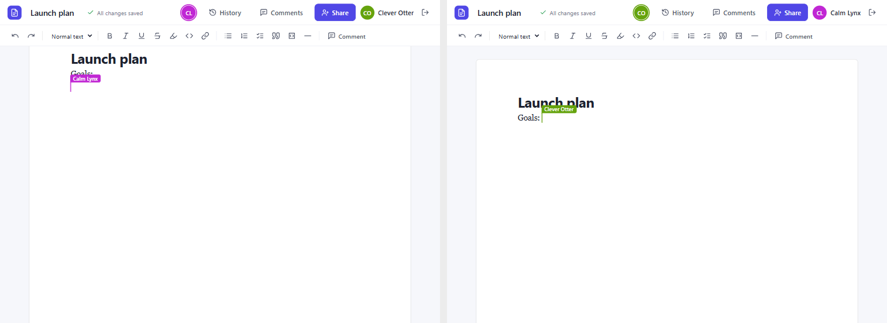
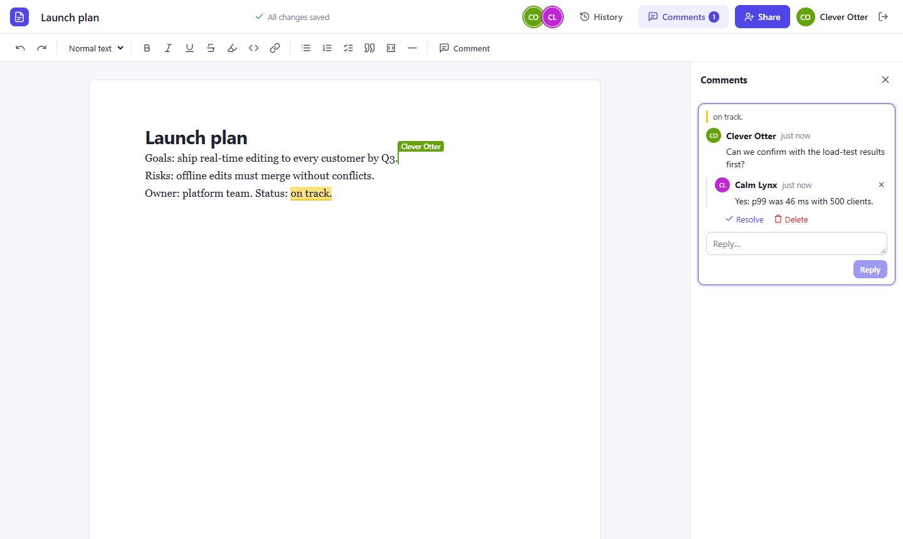
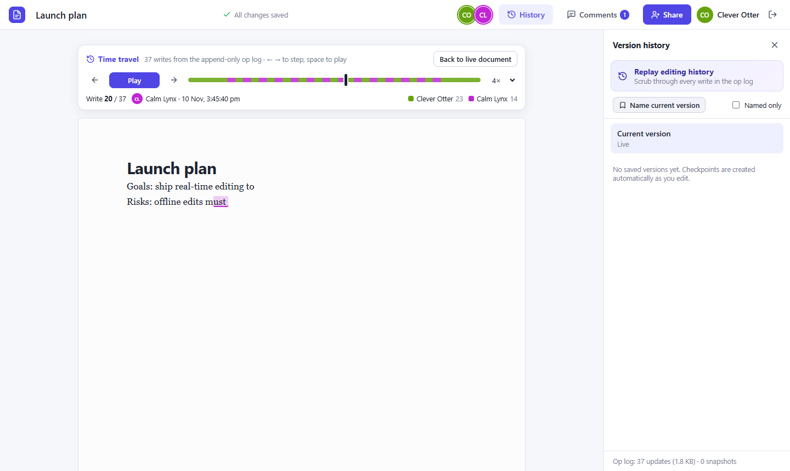
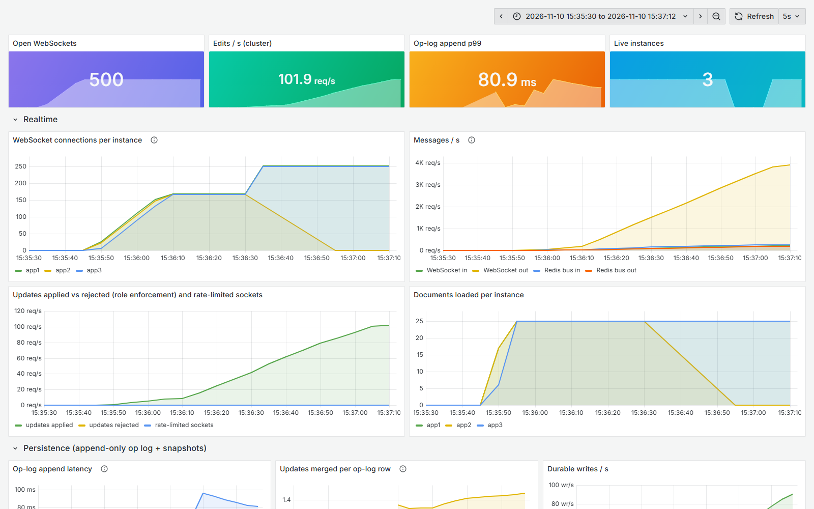
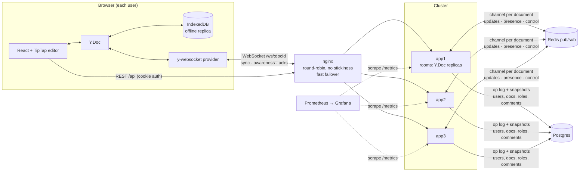
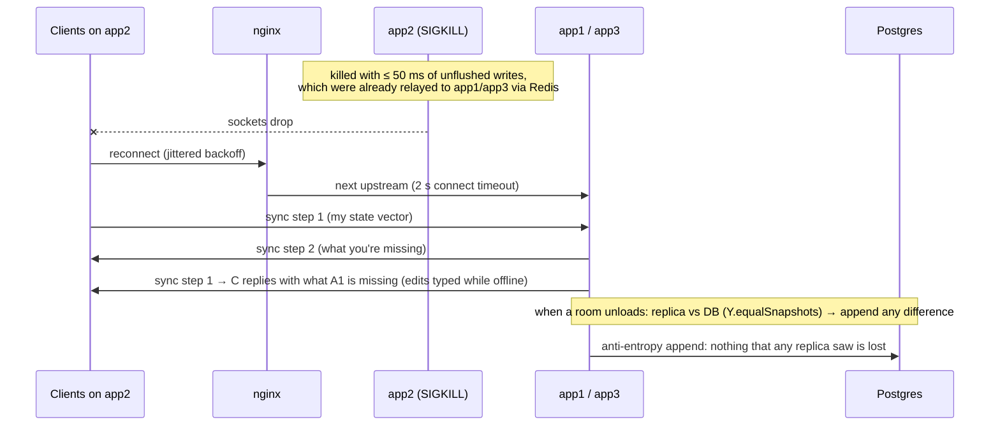

# CollabDocs

**A real-time collaborative editor (think Google Docs) built to survive the failures that real systems hit.** Multiple people edit the same rich-text document with live cursors, keep typing offline, and merge conflict-free through the **Yjs CRDT**. It runs as a horizontally scaled cluster of stateless Node instances behind a load balancer with **no sticky sessions**, coordinated over **Redis pub/sub**, and persisted to **Postgres** as an append-only op log plus snapshots.

     



<sub>Two separate browsers, two users, one document: concurrent typing, live named cursors, presence, and server-confirmed saves. Recorded from the real app by [`e2e/scripts/capture.mjs`](e2e/scripts/capture.mjs).</sub>

## Highlights

|                                           |                                                                                                                                                                                                                                                                                                                            |
| ----------------------------------------- | -------------------------------------------------------------------------------------------------------------------------------------------------------------------------------------------------------------------------------------------------------------------------------------------------------------------------- |
| 💥 **Survives a node being killed**       | SIGKILL one of 3 instances under 500 live clients: **166 sockets failed over and resynced (p99 0.93 s), 113,962 / 113,962 edits delivered, 25 / 25 documents durable.** This runs again [in CI on every push](.github/workflows/ci.yml). ([results](docs/load-test-results.md#run-2-chaos-killing-an-instance-under-load)) |
| ⚡ **Fast at scale**                      | 500 concurrent editors on one laptop: **p50 6 ms / p99 46 ms** end-to-end (client → nginx → instance → Redis → instance → client), 100% delivery                                                                                                                                                                           |
| 🧪 **Correctness is tested, not assumed** | A seeded **property-based fuzzer** runs random concurrent edits, network partitions, failovers, and a `kill -9` of a node holding unflushed writes, then requires every replica _and the database_ to be identical. **Mutation-checked:** disable the anti-entropy step and every seed fails                               |
| ⏪ **Time travel**                        | Scrub through every write in a document's history, replayed from the append-only op log, with each change highlighted in its author's colour                                                                                                                                                                               |
| 💾 **"Saved" means durable**              | The server acks each op-log write with a CRDT state vector, and the UI says _saved_ only once your own edits are in Postgres                                                                                                                                                                                               |
| 🔐 **Permissions at the protocol level**  | View / comment / edit roles enforced on the WebSocket (a modified client still can't write), server-stamped presence identity, live revocation across instances, per-socket rate limiting, CSP                                                                                                                             |
| 📈 **Observable**                         | Prometheus metrics and a provisioned Grafana dashboard: sockets per node, fan-out, op-log latency histograms, batch sizes, event-loop lag                                                                                                                                                                                  |
| 📝 **Documented decisions**               | [ADRs](docs/adr) explain each major trade-off, plus a [CRDT vs OT write-up](docs/crdt-vs-ot.md)                                                                                                                                                                                                                            |

<table>
<tr>
<td width="50%"><br/><sub>Comments anchored with CRDT relative positions, so highlights survive concurrent edits</sub></td>
<td width="50%"><br/><sub>Time travel: author-coloured timeline of every write</sub></td>
</tr>
<tr>
<td colspan="2"><br/><sub>Grafana during the chaos test: app2 is killed, app1/app3 absorb its 166 clients, and nothing is lost</sub></td>
</tr>
</table>

---

## Quick start

**Requirements:** Node 22+. Docker is only needed for the cluster.

```bash
npm install
npm run dev
```

Open http://localhost:5173 and click **"Try it instantly as a guest"**. No database setup is needed: in development the server runs **embedded Postgres (PGlite)** and in-process pub/sub. Data lives in a per-user directory outside the repo (`%LOCALAPPDATA%\collabdocs`, `~/.local/share/collabdocs`, or `~/Library/Application Support/collabdocs`), because database files inside synced folders like OneDrive break. Override it with `PGLITE_DIR`.

To try collaboration on your own:

- Open the document in a second browser profile, or create a share link (**Share → Create link**) and let a bot join through it and type:

```bash
npm run bot -- http://localhost:5173/join/<token>
```

- Click **Go offline**, type in both windows, then reconnect and watch the edits merge.
- Open **History → Replay editing history** to scrub through every write.
- Demo accounts: `npm run seed` (credentials are listed in [loadtest/seed.mjs](loadtest/seed.mjs)).

### The full cluster

```bash
docker compose up -d --build --wait
```

|                           |                                                                  |
| ------------------------- | ---------------------------------------------------------------- |
| App (nginx → 3 instances) | http://localhost:8080                                            |
| Grafana dashboard         | http://localhost:3000                                            |
| Prometheus                | http://localhost:9090                                            |
| Instances directly        | http://localhost:4001 · 4002 · 4003 (`/metrics`, `/api/metrics`) |

To break it yourself, run a load test and kill an instance halfway through:

```bash
npm run loadtest -- --url http://localhost:8080 --clients 500 --docs 25 --rate 0.2 --duration 60 \
  --chaos-cmd "docker compose -f ../docker-compose.yml kill app2" --chaos-at 20 \
  --recover-cmd "docker compose -f ../docker-compose.yml start app2" --recover-at 40 \
  --metrics http://localhost:4001,http://localhost:4002,http://localhost:4003
```

### Tests

```bash
npm test             # server integration + fuzz tests, client unit tests
npm run test:e2e     # Playwright: two real browsers (set PW_CHANNEL=msedge|chrome to use an installed browser)
npm run typecheck && npm run format:check
```

---

## Architecture



Every instance with clients on a document holds an in-memory replica of it (a **room**). Two collaborators usually land on _different_ instances, by design: the CRDT makes cross-instance relay order-independent, so no sticky sessions or per-document leader are needed ([ADR 0003](docs/adr/0003-no-sticky-sessions.md)).

### Life of an edit

```mermaid
sequenceDiagram
  autonumber
  participant A as Alice (browser)
  participant I1 as Instance 1
  participant R as Redis
  participant I2 as Instance 2
  participant B as Bob (browser)
  participant DB as Postgres

  A->>A: keystroke → ProseMirror tr → Yjs update (applied locally, instant)
  A->>I1: [sync/update] binary Yjs update
  I1->>I1: rate limit + role check (editor?) → apply to room replica
  par fan-out
    I1-->>I1: send to other local sockets
  and
    I1->>R: PUBLISH collabdocs:doc:{id}
    R->>I2: message
    I2->>I2: apply (origin=remote, never re-persisted)
    I2->>B: [sync/update]
  and
    I1->>I1: buffer ≤ 50 ms, merge per author
    I1->>DB: BEGIN; UPDATE documents SET update_seq+1 (row lock); INSERT doc_updates; COMMIT
    I1->>A: [saved] state vector → "All changes saved"
  end
```

### What happens when an instance dies



## How it works

<details open>
<summary><b>Persistence: append-only op log + snapshots</b> (<a href="docs/adr/0002-op-log-and-snapshots.md">ADR 0002</a>)</summary>

- **`doc_updates`** is the append-only log of binary Yjs updates, **one row per author per 50 ms flush**. The per-document `seq` is allocated with `UPDATE documents SET update_seq = update_seq + 1 … RETURNING` inside the insert transaction. The row lock serialises appends across _all_ instances, so readers always see a gap-free prefix of the log. A global `BIGSERIAL` couldn't guarantee that: concurrent transactions commit out of id order.
- **`doc_snapshots`** hold the compacted state at a `seq`: every 100 appends or 60 s, on room unload, and for named versions. They are **built from the database, not from memory**, so instances racing to snapshot are always correct.
- **Load** = latest snapshot + log tail. **Restore** is a _forward_ edit that replaces content with a copy of an old version (after checkpointing), so concurrent editors converge as usual and a restore can itself be undone.
- **Time travel** replays rows `1..n` from an empty doc, with checkpoints every 100 rows for fast scrubbing. Because the log is never rewritten, that is exactly the state after write _n_.
- **Saved acks** (message `100`) carry the state vector covered by a write. "Saved" means your own client ID's clock is covered, i.e. durable rather than merely sent.

</details>

<details>
<summary><b>Multi-instance correctness</b></summary>

| Concern                                     | Mechanism                                                                                                                                            |
| ------------------------------------------- | ---------------------------------------------------------------------------------------------------------------------------------------------------- |
| Edits on instance A reach clients on B      | Redis channel per document; envelopes carry the origin instance, so echoes are dropped                                                               |
| Each edit persisted exactly once            | Only the instance whose client produced an update writes it; relayed copies are memory-only                                                          |
| A room opened late misses unflushed updates | **subscribe → load from DB → publish `SYNC_REQUEST(state vector)`**; peers reply with the diff + their clients' presence                             |
| An instance crashes before flushing         | Clients fail over and resync; rooms reconcile replica vs DB on unload (**anti-entropy**). Duplicates are harmless because Yjs updates are idempotent |
| REST change on A affects sockets on B       | `CONTROL` events on the same channel: title, comments, versions, access (revocation → close `4403` everywhere)                                       |
| Restarted container gets a new IP           | nginx `resolve` on upstreams + Docker DNS                                                                                                            |
| Slow or abusive clients                     | 8 MB send-buffer cutoff; token-bucket rate limit (close `4529`, retryable)                                                                           |
| Graceful deploys                            | Close sockets with `1012` (clients reconnect elsewhere), flush, snapshot, unsubscribe                                                                |

</details>

<details>
<summary><b>Offline editing</b></summary>

The browser keeps a full replica in IndexedDB. While disconnected, edits apply locally and are stored on the device. On reconnect, both sides exchange **state vectors** and send only what the other lacks. The server applies offline edits like any other edit, then persists, relays, and acks them. Local copies are wiped on sign-out.

</details>

<details>
<summary><b>Permissions and security</b> (<a href="docs/adr/0004-server-enforced-permissions.md">ADR 0004</a>)</summary>

Roles: **owner > editor > commenter > viewer**.

1. **REST:** every route resolves the caller's role. Non-members get **404**, not 403, so IDs can't be probed.
2. **WebSocket:** viewer and commenter sockets sync _down_ and share presence, but their `sync step 2` and `update` messages are dropped server-side.
3. **Presence:** the server overwrites the `user` field of every awareness state with the authenticated identity, so cursors can't be spoofed.
4. **Live changes:** demotions and removals take effect on open sockets across the cluster within one pub/sub hop.

Also: bcrypt, JWT in an httpOnly SameSite=Lax cookie, timing-safe login, WebSocket Origin allow-list, auth rate limiting, strict CSP, `X-Frame-Options: DENY`, and IndexedDB cleared on sign-out.

</details>

<details>
<summary><b>Comments</b></summary>

Comments live in Postgres, so the commenter role can be enforced server-side. They are anchored with **`Y.RelativePosition`s**: CRDT item IDs rather than character offsets, so highlights stay on the right words whatever concurrent edits happen around them. If the anchored text is deleted, the thread is shown as "text was removed".

</details>

<details>
<summary><b>Observability</b></summary>

Each instance exposes `/metrics` (Prometheus, own registry, bounded label cardinality):

| Metric                                                                                | Type      |
| ------------------------------------------------------------------------------------- | --------- |
| `collabdocs_ws_connections`, `collabdocs_rooms`                                       | gauge     |
| `collabdocs_ws_messages_total{direction}`, `collabdocs_bus_messages_total{direction}` | counter   |
| `collabdocs_updates_total{result="applied\|rejected"}`                                | counter   |
| `collabdocs_ws_connections_total{outcome="accepted\|rejected\|rate_limited"}`         | counter   |
| `collabdocs_oplog_append_seconds`, `collabdocs_oplog_batch_updates`                   | histogram |
| `collabdocs_room_load_seconds`, `collabdocs_snapshot_seconds`                         | histogram |
| `collabdocs_http_request_seconds{method,route,status}`                                | histogram |
| Node.js runtime (event-loop lag, GC, memory, CPU)                                     | default   |

The dashboard in [deploy/grafana](deploy/grafana/dashboards/collabdocs.json) is provisioned automatically by `docker compose`.

</details>

## Performance

Measured on one laptop running the cluster _and_ the load generator ([full report](docs/load-test-results.md)):

| Scenario                                   | Connected                               | Delivered             | End-to-end latency                                                               | Converged / durable |
| ------------------------------------------ | --------------------------------------- | --------------------- | -------------------------------------------------------------------------------- | ------------------- |
| 500 clients, 25 docs, 1 edit / 5 s each    | 500 / 500                               | 113,734 / 113,734     | **p50 6.2 ms · p95 25.5 ms · p99 45.9 ms**                                       | 25 / 25 · 25 / 25   |
| Same, **SIGKILL 1 of 3 instances mid-run** | 500 / 500 (166 failed over, p99 0.93 s) | **113,962 / 113,962** | p50 4.9 ms · p99 53 ms                                                           | 25 / 25 · 25 / 25   |
| 500 clients, 1 edit / s each (stress)      | 500 / 500                               | 335,958 / 335,958     | p50 602 ms: the _generator_ saturated (its loop lag p99 1.3 s; servers' ≈ 60 ms) | 25 / 25 · 25 / 25   |

## Testing

**47 automated tests plus a chaos job:**

- **Server: 34 integration and property tests** with real HTTP/WebSocket servers, driven by the same `y-websocket` client the browser uses. They cover:
  - Access: auth, the role matrix, 404-not-403, and live demotion/kick.
  - Protocol: server rejection of writes from read-only sockets, presence-identity stamping, and rate limiting.
  - Persistence: durable acks, gap-free seqs under concurrency, snapshot ≡ log replay, restarts, offline merges, version restore and undo, op-log replay fidelity, and per-author attribution.
  - Cluster: 3 instances covering cross-node edits and presence, exactly-once persistence, and late-joiner sync.
  - Operability: Prometheus output.
  - **Convergence fuzzing** across 4 seeds × 220 random operations, with partitions, failovers, and a node crash.
- **Client: 8 unit tests** covering the save-state machine and time-travel scrubbing across checkpoints.
- **E2E: 5 Playwright tests** with two real browsers covering live co-editing (cursors, presence), viewer enforcement, offline-merge, comments, and time travel.
- **CI** ([workflow](.github/workflows/ci.yml)):
  - Format, typecheck, tests, and build on Node 22 and 24.
  - The server suite against **real Postgres + Redis**.
  - Playwright E2E.
  - A **chaos job** that boots the Docker cluster, kills an instance under 150 clients, and fails unless delivery is 100%, every dropped client resynced, and every document converged and reloaded intact.

## Design decisions

- [ADR 0001: CRDT (Yjs) over Operational Transformation](docs/adr/0001-crdt-over-ot.md) (plus the [long-form comparison](docs/crdt-vs-ot.md))
- [ADR 0002: Append-only op log + snapshots built from the database](docs/adr/0002-op-log-and-snapshots.md)
- [ADR 0003: Stateless instances, no sticky sessions, Redis relay](docs/adr/0003-no-sticky-sessions.md)
- [ADR 0004: Permissions enforced at the protocol level](docs/adr/0004-server-enforced-permissions.md)

<details>
<summary><b>Wire protocol</b></summary>

Messages 0–3 are the standard y-websocket protocol, so the stock `WebsocketProvider` runs unmodified. Extensions are registered via `provider.messageHandlers`.

| Type                | Direction       | Payload                                                                |
| ------------------- | --------------- | ---------------------------------------------------------------------- |
| `0` sync            | both            | y-protocols sync step 1 / step 2 / update                              |
| `1` awareness       | both            | cursor/selection/user; `user` is overwritten server-side               |
| `3` query awareness | client → server |                                                                        |
| `100` saved         | server → client | state vector durably covered by the op log                             |
| `101` control       | server → client | JSON: `title`, `comments`, `access`, `versions`, `restored`, `deleted` |

Close codes: `4401` unauthenticated, `4403` forbidden/revoked, `4404` missing (terminal); `4529` rate-limited and `1012` restarting (reconnect).

</details>

<details>
<summary><b>REST API</b></summary>

| Method               | Path                                                 | Role                                              |
| -------------------- | ---------------------------------------------------- | ------------------------------------------------- |
| POST                 | `/api/auth/signup` · `/login` · `/guest` · `/logout` |                                                   |
| GET / PATCH          | `/api/auth/me`                                       | signed in                                         |
| GET / POST           | `/api/docs`                                          | signed in                                         |
| GET · PATCH · DELETE | `/api/docs/:id`                                      | viewer · editor · owner                           |
| GET                  | `/api/docs/:id/members`                              | viewer                                            |
| PATCH · DELETE       | `/api/docs/:id/members/:userId`                      | owner (or yourself, to leave)                     |
| GET · POST · DELETE  | `/api/docs/:id/links[/:token]`                       | owner                                             |
| GET · POST           | `/api/share/:token[/accept]`                         | signed in                                         |
| GET · POST           | `/api/docs/:id/versions`                             | viewer · editor                                   |
| GET                  | `/api/docs/:id/versions/:vid/state`                  | viewer (binary Yjs update)                        |
| POST                 | `/api/docs/:id/versions/:vid/restore`                | editor                                            |
| GET                  | `/api/docs/:id/oplog?after=&limit=`                  | viewer (binary frames for time travel)            |
| GET · POST           | `/api/docs/:id/comments`                             | viewer · commenter                                |
| PATCH · DELETE       | `/api/docs/:id/comments/:cid`                        | commenter (body: author; delete: author or owner) |
| GET                  | `/api/health`, `/api/metrics`, `/metrics`            |                                                   |

</details>

## Project layout

```
server/            Node + Express + ws (TypeScript, strict)
  src/collab/      room.ts (replica, fan-out, batching, acks, rate limits, anti-entropy)
                   server.ts (rooms, auth on upgrade), persistence.ts (op log + snapshots),
                   pubsub.ts (Redis / in-memory), protocol.ts
  src/routes/      auth, documents (CRUD, members, links, versions, op log, comments)
  src/metrics.ts   Prometheus registry + telemetry
  test/            api, collab, persistence, cluster, fuzz
client/            React + Vite + TipTap
  src/lib/         collab.ts (Y.Doc + IndexedDB + WebSocket), saveStatus.ts, oplog.ts (time travel)
  src/editor/      toolbar, comment anchors, change highlighting
  src/components/  presence, comments, history, replay, share dialog
e2e/               Playwright tests + README media capture
loadtest/          headless client with failover, load + chaos generator, demo bot, seed
deploy/            nginx, Prometheus, Grafana (provisioned dashboard)
docs/              ADRs, CRDT vs OT, load-test results, images
```

## Deploying

The Docker image serves the API, WebSocket endpoint and built SPA from one container, so any container host works. Single instance: set `DATABASE_URL`, `JWT_SECRET`, and `COOKIE_SECURE=true` behind HTTPS (without `DATABASE_URL` it uses PGlite; mount a volume at `PGLITE_DIR`). Multiple instances: add `REDIS_URL` and put any WebSocket-capable load balancer in front ([deploy/nginx.conf](deploy/nginx.conf)).

<details>
<summary>Configuration</summary>

| Variable                                          | Default              | Purpose                                              |
| ------------------------------------------------- | -------------------- | ---------------------------------------------------- |
| `PORT`                                            | `4000`               | HTTP + WebSocket port                                |
| `DATABASE_URL`                                    | (unset → PGlite)     | Postgres connection string                           |
| `PGLITE_DIR`                                      | per-user data dir    | embedded DB directory (`memory://` for RAM)          |
| `REDIS_URL`                                       | (unset → in-process) | cross-instance pub/sub                               |
| `JWT_SECRET`                                      | dev value            | **required in production**                           |
| `COOKIE_SECURE`                                   | `true` in production | `false` for plain-http local clusters                |
| `ALLOWED_ORIGINS`                                 | (any)                | origins allowed to open WebSockets                   |
| `WS_RATE_LIMIT`                                   | `100`                | messages/s per socket (bursts of 2×); `0` disables   |
| `FLUSH_INTERVAL_MS`                               | `50`                 | op-log batching window                               |
| `SNAPSHOT_EVERY_FLUSHES` / `SNAPSHOT_INTERVAL_MS` | `100` / `60000`      | snapshot cadence                                     |
| `ROOM_IDLE_MS`                                    | `10000`              | unload a room this long after its last client leaves |
| `AUTH_RATE_LIMIT`                                 | `100` in production  | auth requests per IP per 15 min                      |
| `PROCESS_METRICS`                                 | `true`               | Node runtime metrics on `/metrics`                   |

</details>

## Known limitations

- **ProseMirror ↔ Yjs mapping is diff-based** (y-prosemirror). If two users split _indistinguishable_ empty paragraphs at the same moment, text can land in a different paragraph than intended. Replicas still converge, and nothing is lost. CollabDocs disables auto-inserted trailing paragraphs, which otherwise create such nodes from every client.
- Comments aren't part of the CRDT, so creating one needs a connection.
- After failover, sockets stay where they landed (no active rebalancing).
- The op log is kept forever; pruning behind the oldest retained snapshot would cap storage.
- Offline support covers network drops while the app is open; a service worker would allow offline cold starts.

## License

[MIT](LICENSE)
