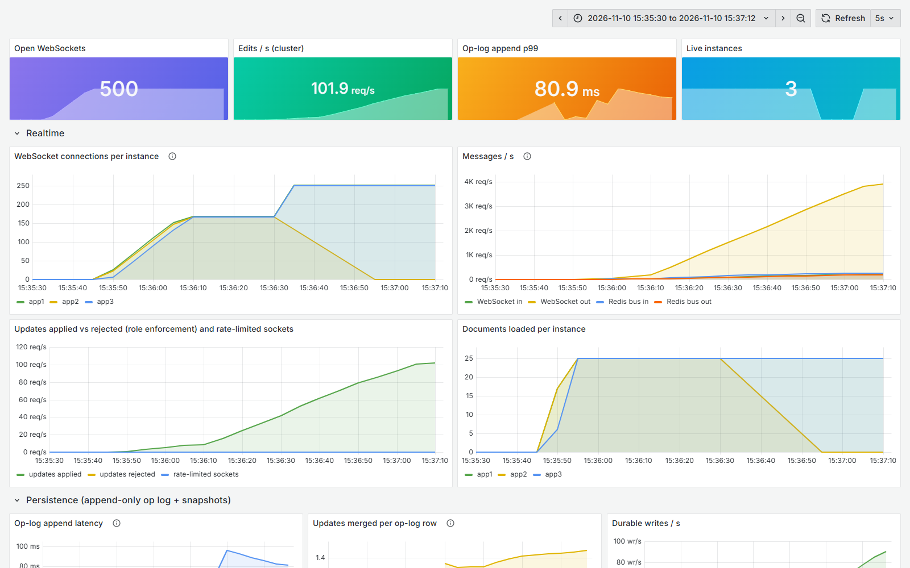

# Load test results (M5)

**Bottom line:** a 3-instance CollabDocs cluster on one laptop held **500 concurrent editors**. Every edit reached every collaborator, every document converged to the same CRDT state, and every document reloaded intact from Postgres. At a realistic editing pace, end-to-end latency through the load balancer and Redis was **p50 6 ms / p99 46 ms**. **SIGKILLing one of the three instances mid-run lost zero edits:** its 166 clients failed over and resynced within a second.

Raw results: [run-500-clients-realistic.json](load-tests/run-500-clients-realistic.json), [run-500-clients-chaos.json](load-tests/run-500-clients-chaos.json), [run-500-clients.json](load-tests/run-500-clients.json).
Generator: [loadtest/loadtest.mjs](../loadtest/loadtest.mjs) (worker threads + headless y-websocket clients).

## Setup

|             |                                                                                                                                                                                                                                                                                                   |
| ----------- | ------------------------------------------------------------------------------------------------------------------------------------------------------------------------------------------------------------------------------------------------------------------------------------------------- |
| Cluster     | `docker compose`: 3 × CollabDocs (Node 24, one event loop each), nginx round-robin **without sticky sessions**, Postgres 17, Redis 7                                                                                                                                                              |
| Host        | One laptop: Intel i5-13420H (12 threads), 16 GB RAM, Windows 11 + Docker Desktop (WSL2). **The load generator ran on the same machine and competed with the cluster for CPU**                                                                                                                     |
| Clients     | 500 WebSocket clients in 6 worker threads, through `http://localhost:8080` (nginx). 50 distinct users, 25 documents, 20 editors per document                                                                                                                                                      |
| Each client | Syncs, then appends a word to its own paragraph and writes a timestamped probe into the doc at a fixed rate. Moves its cursor (awareness) every 5 s                                                                                                                                               |
| Measured    | **End-to-end latency** = time from one client's edit until each _other_ client in the document has applied it (writer → nginx → instance → Redis → instance → nginx → reader). All clients share a clock, so this is true one-way latency                                                         |
| Checks      | **Delivery**: every probe reached every other client in its doc. **Convergence**: all replicas of each doc end with an identical state vector and delete set. **Durability**: after all clients disconnect and rooms unload, a fresh client loads each doc from Postgres and gets that same state |

Connections spread evenly across instances (164–168 each), so a typical document had editors on all three instances, and most edits crossed Redis.

## Run 1: realistic pace (1 edit / 5 s per client)

500 clients × 25 docs, 60 s measurement window, 20 s ramp.

| Metric                           | Result                                                                                                               |
| -------------------------------- | -------------------------------------------------------------------------------------------------------------------- |
| Connections                      | **500 / 500**, 0 failed, 0 unexpected disconnects                                                                    |
| Connect (WS handshake via nginx) | p50 7.1 ms · p95 15.9 ms · p99 26.8 ms                                                                               |
| Initial sync (step 1 → step 2)   | p50 2.0 ms · p99 6.1 ms                                                                                              |
| Edits sent                       | 5,986 (100/s cluster-wide)                                                                                           |
| Deliveries                       | **113,734 / 113,734 (100%)**                                                                                         |
| **End-to-end latency**           | **p50 6.2 ms · p90 18.2 ms · p95 25.5 ms · p99 45.9 ms · max 99 ms**                                                 |
| Convergence                      | **25 / 25** documents identical across all replicas                                                                  |
| Durability                       | **25 / 25** documents reloaded from Postgres with the identical state                                                |
| Server event loop (per instance) | utilization 0.25; delay p99 ≈ 12.5 ms (the sampler's resolution is 10 ms, so p50 ≈ 10.2 ms means ≈ 0 ms of real lag) |
| Server memory (RSS)              | 173–198 MB per instance                                                                                              |
| Fan-out                          | ≈ 85k WebSocket messages sent per instance; ≈ 1,850 op-log appends per instance (50 ms batching merges bursts)       |
| Generator                        | event-loop utilization 0.21, delay p99 ≈ 31 ms. Not saturated, so the latency numbers reflect the system             |

## Run 2: chaos, killing an instance under load

Same as run 1, plus fault injection from the generator. **20 s into the window, `docker kill collabdocs-app2-1`** (SIGKILL: no graceful shutdown, no flush, sockets cut). 20 s later, `docker start`. Clients behave like the browser: jittered exponential backoff, reconnect through nginx (2 s connect timeout, next-upstream retry), then the Yjs sync handshake. They keep typing while disconnected.

| Metric                                                | Result                                                                                                                      |
| ----------------------------------------------------- | --------------------------------------------------------------------------------------------------------------------------- |
| Clients cut off by the kill                           | 166 (every socket on app2)                                                                                                  |
| Reconnected **and resynced**                          | **166 / 166**. Time from drop to resynced: p50 413 ms · p95 842 ms · p99 926 ms                                             |
| Deliveries (including edits typed while disconnected) | **113,962 / 113,962 (100%)**                                                                                                |
| End-to-end latency                                    | p50 4.9 ms · p95 20 ms · p99 53 ms · max 941 ms (the failover itself)                                                       |
| Convergence / durability                              | **25 / 25** identical replicas · **25 / 25** reloaded intact from Postgres                                                  |
| After the kill                                        | app1 and app3 carried 251 and 249 sockets at event-loop utilization ≈ 0.28; app2 came back healthy and took new connections |



_Grafana during the run: app2's connections and rooms drop to zero at the kill, app1/app3 absorb them, and the cluster never falls below 500 sockets for longer than the reconnect window._

How zero loss is achieved, given that the killed process held up to 50 ms of unflushed writes:

1. Every edit app2 received had already been relayed through Redis to the other instances holding that document.
2. Its authors keep a full replica. On reconnect, the sync handshake sends the new instance anything it lacks.
3. When rooms unload, each instance's anti-entropy step compares its replica with Postgres and appends any difference. That's how edits that only existed in app2's unflushed buffer _and_ other instances' memory become durable.

The same scenario runs on every push: the [CI](../.github/workflows/ci.yml) `chaos` job kills an instance under 150 clients and fails the build unless delivery is 100%, every dropped client resynced, and every document converged and reloaded intact. The in-process [fuzz test](../server/test/fuzz.test.ts) covers step 3 directly: disable anti-entropy, and every seed loses data.

## Run 3: stress (1 edit / s per client)

Same topology with 5× the edit rate: 500 updates/s offered, each fanned out to 19 peers, ≈ 10k deliveries/s.

| Metric                          | Result                                                                                                           |
| ------------------------------- | ---------------------------------------------------------------------------------------------------------------- |
| Connections                     | **500 / 500**, 0 failed, 0 unexpected disconnects                                                                |
| Edits sent                      | 17,682 (295/s achieved of 500/s offered; see below)                                                              |
| Deliveries                      | **335,958 / 335,958 (100%)**                                                                                     |
| End-to-end latency              | p50 602 ms · p95 1.65 s · p99 2.22 s · max 4.26 s                                                                |
| Convergence / durability        | **25 / 25** and **25 / 25**                                                                                      |
| Server event loop               | utilization 0.67–0.68; delay p50 ≈ 10.5 ms, p99 ≈ 60–66 ms                                                       |
| Server memory                   | 240–257 MB per instance                                                                                          |
| Container CPU (sampled mid-run) | each app ≈ 60%, Postgres ≈ 60%, nginx ≈ 100%, Redis ≈ 8%                                                         |
| Generator                       | event-loop utilization 0.69 over its whole life (≈ 100% during the window); **event-loop delay p99 ≈ 1.1–1.4 s** |

**How to read this run.** The latency here mostly comes from the load generator, not the servers. The generator's own event loop was delayed by up to about 1.3 s (p99), which is larger than the measured edit latency. The servers' loops never lagged more than about 66 ms (p99). The generator also couldn't reach its target send rate (295 of 500 edits/s). It was sharing 12 laptop threads with three app instances, nginx, and Postgres. Even so, nothing was lost: 100% delivery, convergence, and durability held under saturation.

An earlier stress run, before switching the latency probe from a `Y.Array` to a `Y.Map` to make the generator cheaper, measured p50 ≈ 1.0 s with the same perfect delivery and convergence. That shows the measurement was generator-bound.

## What this demonstrates

- **Horizontal scaling without stickiness.** Collaborators were deliberately spread across instances. Redis relayed about 9–16k inter-instance messages per instance per run, and every replica still converged. The order in which updates arrive doesn't matter to a CRDT.
- **Single-writer persistence across instances.** Each edit is appended only by the instance whose client made it (the cluster test checks this exactly). Relayed copies are never re-persisted. The 50 ms batching window merged bursts: about 0.7 op-log rows per edit in the stress run (12,791 rows for 17,682 edits).
- **Durability under load.** After the run, rooms unloaded on all instances (flush, anti-entropy check, snapshot). Fresh clients then loaded all 25 documents from Postgres byte-identical (by state vector and delete set) to the final in-memory replicas.
- **Headroom.** At a realistic pace each instance's event loop was about 75% idle, serving about 167 sockets.

## Reproduce

```bash
docker compose up -d --build --wait
npm run loadtest -- --url http://localhost:8080 --clients 500 --docs 25 --users 50 --duration 60 --ramp 20 --rate 0.2 \
  --metrics http://localhost:4001,http://localhost:4002,http://localhost:4003 --out docs/load-tests/my-run.json
```

Useful flags: `--rate` (edits per client per second), `--workers` (generator threads), `--awareness-every` (seconds), `--unload-wait` (seconds before the durability check; keep it above `ROOM_IDLE_MS`).

For cleaner numbers at higher rates, run the generator on a separate machine from the cluster.
